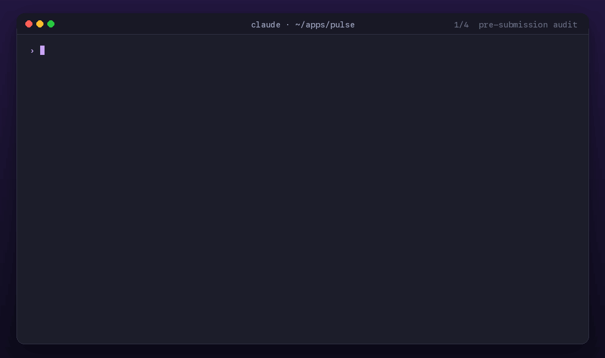

# appstore-review-skill

A Claude Code plugin that checks iOS and Android apps against Apple's App Review Guidelines and Google Play's Developer Program Policies before you submit. When a review comes back rejected, it finds the cause in your code and drafts the reply.

[](https://github.com/devsemih/appstore-review-skill/stargazers)
[](https://github.com/devsemih/appstore-review-skill/releases)
[](https://developer.apple.com/app-store/review/guidelines/)
[](https://play.google/developer-content-policy/)
[](LICENSE)



<sub>The demo uses made-up projects. Run `python3 assets/render-demo.py` to regenerate it.</sub>

## Commands

| Command | What it does |
|---------|--------------|
| `/appstore-review` | Audits your project, and optionally the built `.ipa`, against the [App Store Review Guidelines](https://developer.apple.com/app-store/review/guidelines/) |
| `/playstore-review` | Audits your project, and optionally the `.aab` or `.apk`, against the [Google Play Developer Program Policies](https://play.google/developer-content-policy/) |
| `/appstore-rejection` | Takes an App Review rejection message, finds the cause in your code, proposes a fix and drafts a Resolution Center reply |
| `/playstore-rejection` | Takes a Google Play policy email, finds the cause, tells you whether to fix or appeal, lists the Play Console forms to update and drafts the appeal |

Supported project types: Swift, Kotlin/Java, Flutter, React Native, Expo, Kotlin Multiplatform, .NET MAUI, Capacitor, Cordova, Ionic and Unity.

## Installation

With the plugin manager (recommended):

```
/plugin marketplace add devsemih/appstore-review-skill
/plugin install appstore-review-skill
```

Or clone it into your skills folder:

```bash
git clone https://github.com/devsemih/appstore-review-skill ~/.claude/skills/appstore-review-skill
```

Restart Claude Code after installing. To update, run `/plugin marketplace update`, or `git pull` inside the clone.

## Usage

Run these inside your project in Claude Code:

```
/appstore-review                                   # audit the project for the App Store
/appstore-review --build build/MyApp.ipa           # also inspect the built binary
/appstore-review --fix                             # audit, then apply the safe fixes
/playstore-review --build app/build/outputs/bundle/release/app-release.aab
```

If you were rejected, paste the message or point to a file:

```
/appstore-rejection Guideline 5.1.1(v) - Data Collection and Storage. We noticed that your app supports account creation but does not include an option to initiate account deletion...
/playstore-rejection path/to/policy-email.txt
```

You get the rule that was cited, the root cause with a `file:line`, a proposed fix (applied only after you confirm) and a reply you can paste into the Resolution Center or the Play Console appeal form.

## What's new in 2.0

- Two new commands, `/appstore-rejection` and `/playstore-rejection`.
- `--build` inspects the built app. On iOS it looks for the privacy manifest problems behind ITMS-91053, ITMS-91061 and ITMS-90683 emails. On Android it reads the merged manifest, including permissions added by SDKs.
- `--fix` applies safe, mechanical fixes such as purpose strings, privacy manifest entries, ATS exceptions and unused permissions. Larger changes are planned first and wait for your approval.
- Apple's guidelines are updated to the October 16, 2026 revision and Google Play's policies to the October 29, 2026 update.
- Reports are more reliable. The audit runs as three parallel subagents, every finding has a confidence level and a `file:line`, every critical finding is checked again before it is reported, and items you have to verify in App Store Connect or Play Console are listed separately.

The full list is in the [CHANGELOG](CHANGELOG.md).

## How it works

1. Detect the framework, config files, dependencies and features, and write them into one short summary.
2. Optionally inspect the built `.ipa` or `.aab`, since that is what the store actually reviews.
3. Run three subagents in parallel. Each one loads only its part of the guidelines: safety and performance, business and design, or privacy and legal.
4. Re-check every critical finding at its `file:line`, merge duplicates and run a final pass over the ten most common rejection reasons.
5. Write the report with critical issues, warnings, recommendations, manual checks and a verdict of LOW RISK, NEEDS FIXES or HIGH RISK.
6. With `--fix`, apply the safe fixes, propose the larger ones, re-check and print a summary of what changed.

The guideline text is included in [`references/`](references/), split by section, so the skill quotes the actual rule instead of recalling it from memory.

## Accuracy

<!-- EVAL_RESULTS -->

The [`evals/`](evals/) folder contains fixture apps with planted violations, plus decoys that look suspicious but are fine. It runs with `claude plugin eval`; see [`evals/README.md`](evals/README.md) to try it yourself. If you hit a false positive, please [report it](https://github.com/devsemih/appstore-review-skill/issues/new?template=false-positive.yml) so it can become a test case.

## What gets checked

### `/appstore-review`

Section 1, Safety
- Objectionable content in strings and resources
- User generated content and AI content creation apps (guideline 1.2, updated October 2026): filtering, reporting, blocking and protection against nonconsensual imagery
- Kids Category rules, medical apps, physical harm
- Support and contact information
- Data security: ATS, hardcoded server secrets, secure storage

Section 2, Performance
- Placeholder content, debug code and staging URLs in release builds
- Beta, trial or demo labels in the production app
- Every `NS*UsageDescription` checked against the SDKs that need it
- Mentions of other platforms in user-facing text (2.3.10)
- Hidden or dormant features (2.5.19, new in October 2026)
- iPad support, private APIs, dynamic code loading, background modes, IPv6

Section 3, Business
- In-app purchase for digital goods, and Stripe or PayPal used for digital content
- External purchase links and entitlements (3.1.1(a))
- Restore purchases, and subscription terms shown before the purchase button
- Loot box odds, review prompts, crypto, loans and trading apps

Section 4, Design
- Minimum functionality: web wrappers and template apps
- Spam (4.3, rewritten in October 2026): white-label setups with many bundle IDs, saturated categories
- Login services (4.8): an equivalent privacy-focused login when social login is offered, with the listed exceptions
- Extensions, App Clips, Live Activities, push notifications, Apple Pay, mini apps

Section 5, Privacy and legal
- `PrivacyInfo.xcprivacy`, required-reason APIs and third-party SDK manifests (with `--build`, based on the actual binary)
- Account deletion when the app lets users create an account
- App Tracking Transparency for ad and analytics SDKs
- Health, kids and location data, intellectual property, gambling, VPN, MDM and dark patterns

### `/playstore-review`

- Privacy and user data: privacy policy inside the app, Data safety declarations for each SDK, prominent disclosure, account deletion in the app and on the web, Advertising ID
- Permissions: SMS and Call Log (including the January 2027 change to call-based verification), `QUERY_ALL_PACKAGES`, `MANAGE_EXTERNAL_STORAGE`, Accessibility, the new Local Network and Contacts declarations, minimum location scope and the location button, the Photo Picker, foreground service types, exact alarms, full-screen intents and unused permissions
- Monetization and ads: Play Billing for digital goods, subscription and trial disclosures including eligibility-based discounts, disruptive ads, consent before personalized ads
- Restricted content: financial services and loans, gambling, user generated content, health, blockchain, AI-generated content, age-restricted features
- Abuse and deception: dynamic code loading, hidden features, review manipulation, AppFunctions, ad fraud, fake system dialogs
- Families: certified ad SDKs only, no Advertising ID in apps for children, neutral age screens
- Technical: target API level, `debuggable`, cleartext traffic, committed keystores and service account keys, store listing metadata

## Example report

<details>
<summary>Expo project, App Store (shortened)</summary>

```
# App Store Review Compliance Report

## Project Summary
- App Name: Pulse (5 chars)   Bundle ID: com.pulsefit.app
- Framework: Expo SDK 57 (managed)   Deployment Target: iOS 16.0
- Build inspected: yes (build/Pulse.ipa)   Guidelines version: October 16, 2026

## Critical Issues (Will Likely Cause Rejection)

### [CRITICAL] Guideline 4.8: Login Services
**Confidence:** High
**Issue:** Google sign-in creates the main account and no equivalent privacy-focused login is offered.
**Evidence:** `app/(auth)/login.tsx:23`, `Google.useAuthRequest({...})`. Searched for expo-apple-authentication and AppleAuthentication, found neither.
**Fix:** Run npx expo install expo-apple-authentication, add the Apple button and set ios.usesAppleSignIn to true.

### [CRITICAL] Guideline 5.1.1: Privacy manifest (ITMS-91053)
**Confidence:** High
**Issue:** ExpoFileSystem uses disk space APIs, but no privacy manifest declares the DiskSpace category.
**Evidence:** build inspection: `POSSIBLE ITMS-91053: framework 'ExpoFileSystem' references NSPrivacyAccessedAPICategoryDiskSpace APIs ...`
**Fix:** Add the category with reason E174.1 under expo.ios.privacyManifests in app.json.

## Manual Check Required
- [ ] Demo account for the login in App Review Information
- [ ] Privacy nutrition labels: crash data (Sentry), product interaction (PostHog)
- [ ] Screenshots and creative assets follow 2.3.3 and 2.3.14

## Final Verdict
**HIGH RISK**: add Sign in with Apple and fix the privacy manifest first.

Run /appstore-review --fix to apply the safe fixes automatically (2 available).
```
</details>

## Policy versions

| Commands | Source | Version |
|----------|--------|---------|
| `/appstore-review`, `/appstore-rejection` | [App Store Review Guidelines](https://developer.apple.com/app-store/review/guidelines/), sections 1 to 5, full text split by section | October 16, 2026 |
| `/playstore-review`, `/playstore-rejection` | [Google Play Developer Program Policies](https://play.google/developer-content-policy/), all policy areas, summarized | July 2026 plus the October 29, 2026 update |

Apple and Google change these policies several times a year. If something looks out of date, please open an issue or a pull request.

## Contributing

Pull requests are welcome. These help the most:

- [Share a rejection](https://github.com/devsemih/appstore-review-skill/issues/new?template=rejection-report.yml). Real rejections turn into new checks and test cases.
- [Report a false positive](https://github.com/devsemih/appstore-review-skill/issues/new?template=false-positive.yml).
- Add a check in `skills/*/checks/*.md` together with a test case in `evals/`.
- Update the policy text in `references/appstore/` or `references/playstore/`.

## License

MIT, see [LICENSE](LICENSE).

This plugin checks your app against publicly available Apple and Google policies. It can't guarantee approval, so always read the official [App Store guidelines](https://developer.apple.com/app-store/review/guidelines/) and [Google Play policies](https://play.google/developer-content-policy/) before you submit.
